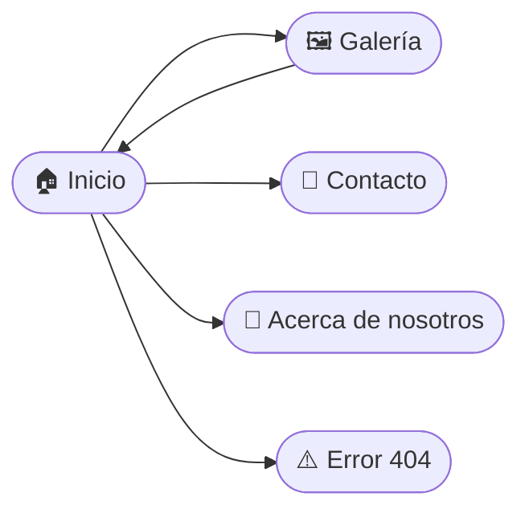
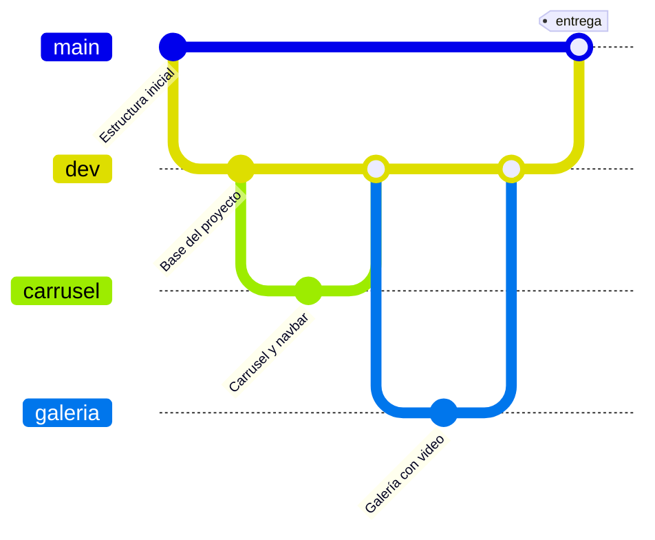

<div align="center">

# 🎮 PIXELZONE

### Reseñas, noticias y guías para gamers

Blog de videojuegos y tecnología, **100 % responsive**, con diseño oscuro, carrusel de destacados, galería de videos interactiva y navegación pensada para todos los dispositivos.

<br>


<br>

[🌐 Ver demo](https://TU-USUARIO.github.io/NOMBRE-DEL-REPO/) · [🐛 Reportar un problema](../../issues) · [👥 Conocer al equipo](#-equipo)

</div>

<!-- COMPLETAR: reemplazar el link de "Ver demo" por la URL real de GitHub Pages / Netlify -->

---

## 📑 Tabla de contenidos

- [Sobre el proyecto](#-sobre-el-proyecto)
- [Características](#-características)
- [Páginas del sitio](#-páginas-del-sitio)
- [Tecnologías](#-tecnologías)
- [Diseño y paleta de colores](#-diseño-y-paleta-de-colores)
- [Diseño responsive](#-diseño-responsive)
- [Estructura del proyecto](#-estructura-del-proyecto)
- [Cómo ejecutarlo](#-cómo-ejecutarlo)
- [Flujo de trabajo con Git](#-flujo-de-trabajo-con-git)
- [Accesibilidad](#-accesibilidad)
- [Próximos pasos](#-próximos-pasos)
- [Equipo](#-equipo)
- [Créditos y aviso legal](#-créditos-y-aviso-legal)

---

<!--
  VISTA PREVIA (opcional pero muy recomendado)
  1. Creá la carpeta docs/ y guardá capturas de pantalla: inicio.png, galeria.png, mobile.png
  2. Descomentá este bloque.

## 📸 Vista previa

| Inicio | Galería | Versión móvil |
|:---:|:---:|:---:|
|  |  |  |
-->

## 🚀 Sobre el proyecto

**PixelZone** es un blog gamer desarrollado como **Proyecto 1: Blog con Bootstrap** del curso Full Stack de **RollingCode School**. Reúne noticias, reseñas y contenido visual del mundo de los videojuegos y la tecnología, con una identidad oscura y violeta pensada para jugadores.

El objetivo fue construir un sitio **multipágina, responsive y accesible** usando HTML semántico, CSS propio y el framework Bootstrap, trabajando en equipo con **Git y GitHub**.

> 💡 **Idea central:** que la interfaz se sienta como parte del universo gamer: oscura, fluida y con interacciones que invitan a explorar.

---

## ✨ Características

| | |
|---|---|
| 🧭 **Navbar inteligente** | Fija arriba, transparente sobre el banner y con efecto *vidrio* (blur) al hacer scroll. En celular se colapsa en un menú desplegable. |
| 🎠 **Carrusel de destacados** | Transición con fundido, avance automático cada 5 s, controles y degradados para que el texto siempre se lea. |
| 📰 **Últimas entradas** | Tarjetas de noticias con imagen, etiqueta, resumen y enlace a la fuente. |
| 🔎 **Barra lateral** | Buscador, categorías (Noticias, Reseñas, Guías, PC, Consolas, Indie, Retro) y espacio publicitario. |
| 🪟 **Ventanas modales** | Suscripción y login con formularios validados por el navegador (`required`, `minlength`, `type="email"`). |
| 🖼️ **Galería con video** | 8 tarjetas: el video se reproduce al pasar el mouse y vuelve a su portada al salir. En celular, un toque reproduce y otro detiene. |
| 🌌 **Banner con video** | Video en bucle que queda detrás del navbar, con degradado que lo funde con el fondo. |
| 🚫 **Página 404 personalizada** | Mantiene el diseño del sitio y un botón para volver al inicio. |
| 📱 **Responsive real** | Probado desde celular hasta escritorio con Bootstrap y media queries propias. |
| ♿ **Accesible** | HTML semántico, textos alternativos, jerarquía de títulos y respeto por `prefers-reduced-motion`. |

---

## 🗺️ Páginas del sitio



| Página | Archivo | Estado |
|---|---|:---:|
| 🏠 Inicio | `index.html` | ✅ Listo |
| 🖼️ Galería | `pages/galeria.html` | ✅ Listo |
| ⚠️ Error 404 | `pages/error404.html` | ✅ Listo |
| 👥 Acerca de nosotros | `pages/acerca.html` | 🚧 En desarrollo |
| 📩 Contacto | `pages/contacto.html` | 🚧 En desarrollo |
| ⭐ Reseñas (artículo) | `pages/resenas.html` | 🗓️ Planificada |

<!-- COMPLETAR: ajustar los estados según cómo estén las páginas de tus compañeros -->

---

## 🛠️ Tecnologías

| Tecnología | Uso en el proyecto |
|---|---|
| **HTML5** | Estructura semántica: `header`, `nav`, `main`, `section`, `article`, `aside`, `figure`, `footer`. |
| **CSS3** | Variables, Flexbox, `position`, degradados, transiciones, `aspect-ratio`, `clamp()` y media queries. |
| **JavaScript (ES6)** | Control de videos en la galería y efecto del navbar al hacer scroll. |
| **Bootstrap 5.3.8** | Grilla, navbar, carrusel, modales, tarjetas y utilidades. Cargado por CDN. |
| **Google Fonts** | **Rajdhani** para títulos y **Inter** para el texto. |
| **Git + GitHub** | Control de versiones, ramas y trabajo colaborativo. |
| **Live Server** | Servidor local durante el desarrollo en VS Code. |

---

## 🎨 Diseño y paleta de colores

El sitio usa un **modo oscuro** con un acento violeta. Todos los colores viven como **variables CSS** en `:root`, por lo que cambiar la paleta es tocar un solo lugar.

| Color | Hex | Variable | Uso |
|---|---|---|---|
|  | `#0E1117` | `--bg` | Fondo de la página |
|  | `#0A0D12` | `--nav-bg` / `--footer-bg` | Navbar y footer |
|  | `#262C3A` | `--border` | Bordes sutiles |
|  | `#7C3AED` | `--primary` | Botones principales |
|  | `#A78BFA` | `--accent` | Resaltes, etiquetas y subrayados |
|  | `#E8EAF0` | `--text` | Texto principal |
|  | `#A0A7B8` | `--muted` | Texto secundario |

**Tipografías:** `Rajdhani` (títulos, estilo tecnológico) · `Inter` (lectura cómoda en pantalla).

**Detalles de interfaz**
- Botones que **suben y brillan** al pasar el cursor.
- Links del navbar con **subrayado violeta animado**.
- Tarjetas de la galería con **zoom suave** y borde de acento al hacer hover.

---

## 📱 Diseño responsive

Se aplicó el enfoque **mobile first** con los breakpoints de Bootstrap.

| Ancho | Dispositivo | Galería |
|---|---|:---:|
| `< 576 px` | Celular | 1 columna |
| `≥ 576 px` | Celular grande / tablet | 2 columnas |
| `≥ 992 px` | Notebook / escritorio | 4 columnas |

- El navbar se **colapsa** en un menú hamburguesa por debajo de 992 px.
- El inicio pasa de una columna a **contenido + barra lateral** desde 992 px.
- Los títulos usan `clamp()` para **escalar con la pantalla** sin saltos bruscos.
- Las tarjetas mantienen su proporción con `aspect-ratio` y `object-fit: cover`.

---

## 📂 Estructura del proyecto

```text
pixelzone/
├── index.html              # Página de inicio
├── README.md
├── css/
│   └── style.css           # Estilos propios (variables, navbar, carrusel, galería...)
├── js/
│   ├── main.js             # Efecto del navbar al hacer scroll
│   └── galeria.js          # Reproducción de videos en la galería
├── img/                    # Imágenes: destacados, noticias y portadas
├── videos/                 # Banner y videos de las tarjetas de la galería
└── pages/
    ├── galeria.html
    ├── acerca.html
    ├── contacto.html
    └── error404.html
```

---

## ⚙️ Cómo ejecutarlo

No necesita instalación ni compilación: es un sitio estático.

**1. Clonar el repositorio**

```bash
git clone https://github.com/LucasMartinez0/gamingblog.git
cd NOMBRE-DEL-REPO
```

**2. Abrirlo con un servidor local** (recomendado, para que carguen bien los videos)

- Con **VS Code**: instalar la extensión **Live Server**, clic derecho sobre `index.html` → *Open with Live Server*.
- O con Python:

```bash
python -m http.server 5500
```

Luego abrir `http://localhost:5500` en el navegador.

> ⚠️ Abrir `index.html` con doble clic funciona para ver el diseño, pero algunos navegadores bloquean videos y rutas relativas desde `file://`. Por eso se recomienda un servidor local.

---

## 🌿 Flujo de trabajo con Git

El equipo trabajó con **ramas por funcionalidad** y unió todo a una rama de integración antes de publicar.



| Rama | Propósito |
|---|---|
| `main` | Versión estable y publicada |
| `dev` | Integración del trabajo del equipo |
| `feat/<nombre>` | Una funcionalidad por rama (por ejemplo `feat/carrusel`) |

**Convención de commits**

```text
feat: agrega la galería con videos
fix: corrige la ruta del banner
style: ajusta colores del footer
docs: actualiza el README
```

<!-- COMPLETAR: ajustar nombres de ramas si el equipo usó otros -->

---

## ♿ Accesibilidad

- `lang="es"` y etiqueta `viewport` en todas las páginas.
- Jerarquía de títulos coherente (`h1` → `h2` → `h3`).
- Textos alternativos en imágenes y `aria-label` en los videos.
- Elementos decorativos ocultos a lectores de pantalla (`aria-hidden`).
- Enlace activo del menú marcado con `aria-current="page"`.
- Foco visible con `:focus-visible` para navegar con teclado.
- Animaciones reducidas con `prefers-reduced-motion`.

---

## 🧭 Próximos pasos

- [x] Estructura base y navbar responsive
- [x] Carrusel de destacados
- [x] Página de inicio con entradas, buscador y categorías
- [x] Modales de suscripción y login
- [x] Galería con banner y videos interactivos
- [x] Página de error 404 personalizada
- [x] Footer con redes y enlaces de información
- [x] Páginas de **Contacto** y **Acerca de nosotros**

---

## 👥 Equipo

<table>
  <tr>
    <td align="center">
      <a href="https://github.com/FranDiaz26">
        <br />
        <b>Francisco Díaz</b>
      </a><br />
      <sub>Integrante del equipo</sub>
    </td>
    <td align="center">
    <a href="https://github.com/LucasMartinez0">
    <br />
      <b>Lucas Martinez</b>
      </a><br />
      <sub>Integrante del equipo</sub>
    </td>
    <td align="center">
    <a href="https://github.com/diegodmb3-pixel">
    <br />
      <b>Diego Borgmann</b>
      </a><br />
      <sub>Integrante del equipo</sub>
    </td>
    <td align="center">
    <a href="https://github.com/jgpicuard">
    <br />
      <b>Javier Picuard</b>
      </a><br />
      <sub>Integrante del equipo</sub>
    </td>
  </tr>
</table>

<!-- COMPLETAR: agregar el rol y el usuario de GitHub de cada compañero, con el mismo formato que Francisco -->

---

## 📜 Créditos y aviso legal

Proyecto **educativo** realizado en **RollingCode School**, sin fines comerciales.

Los nombres, imágenes y videos de videojuegos y marcas (GTA VI, NVIDIA, Minecraft, Valorant y otros) pertenecen a sus respectivos titulares y se utilizan únicamente con fines ilustrativos y educativos. Las noticias enlazan a sus fuentes originales.

---

<div align="center">

**Hecho con 💜 y mucho café por el equipo de PixelZone**

⭐ Si te gustó el proyecto, dejá una estrella en el repositorio

</div>